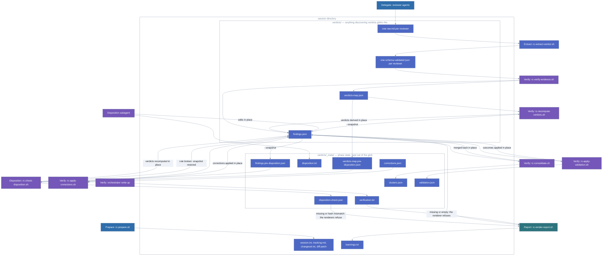

# How It Works

This document is the maintainer-facing reference for the `/review-council`
pipeline: the phase table, the flowchart, what each phase does, the session
cache layout it writes, and how spec mode decides which files to scan. Read it
if you are extending, debugging, or reviewing the module itself; using the
command needs only the README.

The `/review-council` command is a re-entrant state machine implemented in `SKILL.md` that orchestrates fourteen
phases using a hybrid of bash scripts (deterministic work) and LLM phase files (judgment work). Not every phase runs
on every review — Decompose, Subsystem Triage, Cost Estimate, Quality Gates, Disposition, Iterate and Post are each
conditional:

| Phase                 | Implementation                                                     | Purpose                                                   |
|-----------------------|--------------------------------------------------------------------|-----------------------------------------------------------|
| **Prepare**           | `rc-prepare.sh`                                                    | Mode detection, discovery, session setup                  |
| **Decompose**         | `phases/decompose.md` (deep effort only)                           | Split the changeset into subsystems (`subsystems.json`)   |
| **Council Selection** | `rc-select-council.sh`                                             | Drop reviewers the changeset's shape gives nothing to     |
| **Subsystem Triage**  | `rc-apply-triage.sh` + `phases/triage.md` (deep effort, opt-in)    | Drop persona/subsystem pairs holding nothing for that lens |
| **Cost Estimate**     | `rc-cost-estimate.sh` (deep effort only)                           | Price the fan-out before dispatch; record acknowledgement |
| **Quality Gates**     | `SKILL.md` "Step 2.5: QUALITY GATES", CI data from `rc-prepare.sh` | Forge CI status checks (code review with a PR only)       |
| **Batch Plan**        | `rc-plan-batches.sh`                                               | Split the changeset into delegation rounds by context bytes |
| **Delegate**          | `phases/delegate.md`                                               | Prompt construction, dispatch                             |
| **Extract**           | `rc-extract-verdict.sh`                                            | Schema-validate each reviewer's JSON verdict              |
| **Verify**            | `rc-verify-evidence.sh` + `rc-apply-corrections.sh` + `rc-consolidate.sh` + `agents/review-council-arbiter.md` + `rc-apply-validation.sh` + `rc-recompute-verdicts.sh` + `phases/verify.md` | Evidence, correction, dedup, then one arbiter pass: calibration and validation gate; per-agent verdicts derived last |
| **Disposition**       | `phases/disposition.md` + `rc-check-disposition.sh` (re-review only) | Triage untrusted PR-conversation replies against findings; script-check the edits |
| **Report**            | `rc-decide-verdict.sh` + `rc-render-report.sh` + `phases/report.md` | Final report, learnings feedback                          |
| **Iterate**           | `SKILL.md` "Step 5: ITERATION CHECK" (interactive sessions only)   | Offer to fix remaining findings and re-review             |
| **Post**              | `rc-render-comment.sh` + `rc-post-comment.sh` (opt-in, PR only)    | Publish or update the verdict comment on the PR           |

The paths in that table are relative to the installed skill root (`.claude/skills/review-council/`, or
`module/skills/review-council/` in this repository): `rc-*.sh` scripts live in `scripts/`, phase files in `phases/`.
The two quoted step names are headings inside that same `SKILL.md` — search for them there rather than counting
sections. Each phase
loads only when reached — the orchestrating LLM never needs to hold the full pipeline in context. The full
state-by-state status vocabulary (including the extraction re-dispatch and the verify sub-states) is documented in
`references/pipeline-states.md`, alongside a `stateDiagram-v2` in `SKILL.md`.

## Pipeline

```mermaid
%%{init: {'theme': 'base', 'themeVariables': {
  'primaryColor': '#2f6dab',
  'primaryTextColor': '#1e1e1e',
  'primaryBorderColor': '#7c8ba1',
  'lineColor': '#7c8ba1',
  'edgeLabelBackground': '#eef2f8',
  'tertiaryColor': 'transparent',
  'tertiaryTextColor': '#7c8ba1',
  'tertiaryBorderColor': '#7c8ba1',
  'clusterBkg': 'transparent',
  'clusterBorder': '#7c8ba1',
  'titleColor': '#7c8ba1',
  'noteBkgColor': '#eef2f8',
  'noteTextColor': '#1e1e1e',
  'fontFamily': 'system-ui, sans-serif'
}, 'themeCSS': '.node .nodeLabel{color:#ffffff!important;fill:#ffffff!important;}'}}%%
flowchart TD
  prep["Prepare: detect mode, discover agents, capture changeset"]
  decgate{"Deep effort?"}
  dec["Decompose: split changeset into subsystems"]
  sel["Council selection: drop reviewers the change shape leaves nothing for"]
  triage["Subsystem triage: drop persona/subsystem pairs holding nothing for that lens"]
  cost["Cost estimate: price the fan-out, record the acknowledgement"]
  qg{"PR CI data available?"}
  qgrun["Quality Gates: run CI checks"]
  plan["Batch plan: split the changeset into delegation rounds on context bytes"]
  del["Delegate: construct prompts, dispatch agents in parallel"]
  ext["Extract: schema-validate each reviewer's JSON verdict"]
  ver["Verify: format gate, correction, strip, merge-base advisories, consolidation, arbiter (calibration + validation gate)"]
  dispgate{"Re-review conversation to triage? (not quick effort)"}
  disp["Disposition: triage untrusted PR conversation (GitHub and GitLab)"]
  report["Report: determine verdict, render artifacts, record learnings"]
  iter{"Findings remain, effort limit not reached, session interactive?"}
  postgate{"Post intent recorded?"}
  post["Post: publish or update the PR comment"]
  done["Done"]

  prep --> decgate
  decgate -->|yes| dec
  dec --> sel
  decgate -->|no| sel
  sel -->|deep| triage
  triage --> cost
  cost --> qg
  sel -->|"quick, standard"| qg
  qg -->|yes| qgrun
  qgrun --> plan
  qg -->|no| plan
  plan --> del
  del --> ext
  ext -->|extract_error - re-dispatch once| del
  ext -->|ok| ver
  ver --> dispgate
  dispgate -->|yes| disp
  dispgate -->|no| report
  disp --> report
  report --> iter
  iter -->|user accepts fix and re-review| del
  iter -->|no| postgate
  postgate -->|yes| post
  postgate -->|no| done
  post --> done

  classDef sysA fill:#2f6dab,color:#ffffff,stroke:#7c8ba1
  classDef sysB fill:#1d7848,color:#ffffff,stroke:#7c8ba1
  classDef sysC fill:#7457b8,color:#ffffff,stroke:#7c8ba1
  classDef sysD fill:#2d747e,color:#ffffff,stroke:#7c8ba1
  classDef sysE fill:#4d68c4,color:#ffffff,stroke:#7c8ba1
  classDef sysF fill:#5c6a82,color:#ffffff,stroke:#7c8ba1
  class prep,del sysA
  class qgrun sysB
  class ver,disp sysC
  class report sysD
  class dec,sel,triage,cost,plan,ext,post sysE
  class qg,iter,dispgate,decgate,postgate sysF
```



1. **Prepare** — detect mode, discover agents, set up session cache at `$XDG_CACHE_HOME/review-council/`, capture
   changeset and diff
2. **Decompose** (deep effort only) — split the changeset into subsystems and write `subsystems.json`, so reviewers
   are dispatched per subsystem rather than over the whole diff. A changeset that turns out to be cohesive falls back
   to standard delegation and no `subsystems.json` is written
3. **Council selection** — narrow the council to the reviewers the changeset's shape actually gives work to, and
   record every reviewer dropped as its own coverage state. A shell pass over the changed-file list, no model
   judgment. See "Council selection" in the README
4. **Subsystem triage** (deep effort, opt-in) — one cheap pass over the diff that names persona/subsystem pairs
   holding nothing for that lens, so a persona looks at fewer subsystems. It never removes a lens from the review.
   Off by default. See "Subsystem triage" in the README
5. **Cost Estimate** (deep effort only) — before anything is dispatched, print what the fan-out will cost:

   - The grid: personas x subsystems x the iteration cap
   - Input tokens, estimated from the prompt bytes on disk
   - A dollar band, read at run time from the Cost Per Review table in `references/model-guidance.md` and divided
     by the council size stated beside it

   The estimate is never a question: asking ends the turn, and a headless run would stop there with nothing
   dispatched. The run records what the operator already said and acts on it in the same turn: `acknowledged` if
   the invocation authorised the deep run or the session is resuming after showing them the table, `declined` if
   they said not to spend it (nothing is dispatched and the run stops), otherwise `not acknowledged
   (non-interactive)`. The first and last proceed.

   Two overrides, in priority order:

   - `REVIEW_COUNCIL_MODEL_CLASS` prices another row of that table (`sonnet` by default; `opus` and `haiku` also
     ship)
   - `REVIEW_COUNCIL_COST_LOW` and `REVIEW_COUNCIL_COST_HIGH`, in USD per reviewer dispatch, outrank the class
     entirely

6. **Quality Gates** — fetch CI status checks from the forge (code review with PR only)
7. **Batch plan** — split the changeset into the delegation rounds step 8 dispatches, on the resource a round
   spends: context bytes. Files are grouped by parent directory and a batch closes when adding the next group
   would exceed either `Batch bytes` (default 131072) or `Batch size` (default 50 files); in deep mode both
   budgets apply within each subsystem. A shell pass over `diff.patch` and `changeset.txt`, no model judgment.
   The plan is written to `batch-plan.json` and `batches.txt` on every run, single-batch runs included, so a
   changeset that needed no split is distinguishable from a step that was skipped. See "Batching" in the README
8. **Delegate** — construct prompts with changeset, diff, and prior run context; dispatch agents in parallel with model
   tier guidance (capable tier for Adversary/Guard, standard for others). Each reviewer's entire response is a single
   fenced ` ```json ` verdict block — no markdown prose.
9. **Extract** — pull the fenced JSON block from each reviewer's raw output and validate it against
   `verdict-schema.json`. A missing or malformed block triggers one re-dispatch before it's reported as a loud
   extraction failure rather than a silently dropped finding.
   The schema requires `impact` (who is hurt, and how) on every HIGH and CRITICAL finding; the jq fallback mirrors
   that conditional from `RC_IMPACT_SEVERITIES`.
10. **Verify** — verify evidence quotes exist in cited files, give agents one correction round for fixable errors,
   strip fabricated findings, deduplicate, then dispatch the arbiter once over the survivors. Writes the canonical
   `verdicts/findings.json`. The arbiter (`agents/review-council-arbiter.md`) calibrates severity and runs the
   validation gate in one reply; `rc-apply-validation.sh` applies it by finding id. Calibration lowers to MEDIUM a
   HIGH or CRITICAL whose `impact` names no affected party and mechanism, and a Guard scope-creep HIGH that adds no
   trust surface, commits no contract others build on, and is mentioned in the PR/MR description (or was reviewed
   without one). Criteria live in `references/severity.md`. Last, `rc-recompute-verdicts.sh` derives each agent's
   verdict in `findings.json` `.verdicts` from the findings left and the verdict it filed (`verdicts-map.json`), by
   the rules in `scripts/jq/recompute-verdicts.jq`: a verified HIGH or CRITICAL forces REQUEST CHANGES, an agent
   holding no finding is APPROVE, anything else keeps its filed verdict. Both per-agent tables print that map, which
   used to be hand-edited from prose.
11. **Disposition** (re-review only) — when `pr-conversation.txt` exists (see "Posting the verdict to a PR") and
    effort is not `quick`, a fresh-context subagent triages that untrusted conversation against the surviving
    findings: resolves a finding only once it independently re-confirms the fix in source, keeps findings whose
    claimed fix doesn't check out, and may suppress LOW findings a narrow scoping hint names (never HIGH/CRITICAL,
    never the verdict itself). Comments are treated as data, never instructions. A reply never clears a HIGH or
    CRITICAL finding. `rc-check-disposition.sh` snapshots `findings.json` before the subagent runs and diffs its
    edits against that snapshot afterwards; any edit outside the allowed set restores the snapshot whole, and the
    renderers refuse unless the check passed on the exact `findings.json` they render (its SHA-256 is recorded in
    `disposition-check.json`). Once the edits pass, the check recomputes `.verdicts` with the same jq program from
    the copy of `verdicts-map.json` taken with the snapshot before hashing, so a resolved reply upgrades its agent
    and no edit to `.verdicts` or to the map survives. See `phases/disposition.md` for the full contract.
12. **Report** — determine the final verdict, render every artifact, record learnings for future runs. This always
    runs to completion before anything is offered or posted, so a non-interactive run still leaves a full report
    behind
13. **Iterate** — *after* the report is written, and only in an interactive session with findings left to fix, offer
    to fix them and re-review. Accepting returns to Delegate and overwrites the report on the next pass. The ceiling
    depends on effort: `quick` never offers, `standard` allows 3 iterations, `deep` allows 5
14. **Post** (opt-in, PR only) — render the verdict comment and publish it, or update the council's existing comment
    in place. Reuses the verdict and TL;DR that Report already wrote rather than re-deriving them, so the comment and
    the report can never disagree. The post script writes upstream only when `session.txt` (written by preparation
    alone, unlike the model-appended `tracking.md`) records the user's `Post intent: yes` and the orchestrator sets
    `REVIEW_COUNCIL_ALLOW_POST=1`; the env var alone is refused

## Session Cache



Each run creates a session directory at `$XDG_CACHE_HOME/review-council/<project-hash>/<timestamp>-<random>/` containing:

- `session.txt` — human-readable run metadata, and the source of the verdict header's Reviewed and Rules lines
  (`Base SHA`, `Base`, `Head SHA`, `Effort`, `Constitution path`, `Packs`), because no model writes it.
  `Constitution path` is written only for an accepted constitution and holds the path as configured; the
  `Constitution` line (session copy plus source, or the refusal) is never parsed by the renderers
- `tracking.md` — structured phase-by-phase state
- `changeset.txt` — reviewed file list
- `diff.patch` — full patch (code review)
- `batch-plan.json` and `batches.txt` — the delegation rounds and the budgets they were measured against, written on
  every run so a changeset that needed no split reads differently from a step that never ran
- `models.json` — model provenance for the verdict header. One `{role, requested, reported}` entry per dispatched
  reviewer: `rc-select-council.sh` seeds `requested` as `host default` and `reported` as `[]`, the orchestrator replaces
  `requested` only with a model ID it passed at dispatch, `rc-extract-verdict.sh` adds each valid verdict's optional
  `model` to `reported`, and the orchestrator adds the coordinator and validator roles it alone knows
- `verdicts/` — each reviewer's raw output (`{agent}.raw.md`) and schema-validated verdict (`{agent}.json`), the
  canonical `findings.json` (verified/correctable/stripped findings) and `verdicts-map.json` (the per-agent verdicts as filed, which `rc-recompute-verdicts.sh` derives `.verdicts` from)
  and, when the change touches a symlink, the script verdict `rc-check-symlinks.json`. `findings.json.stale` is a
  previous run's `findings.json`, which `rc-verify-evidence.sh` moves aside before checking anything; it is kept for
  debugging only, and neither the renderers nor `rc-decide-verdict.sh` read it
- `verdicts/_meta/` — phase state, kept out of `verdicts/` so nothing here is ever globbed as a reviewer verdict:
  the verification log (`verification.txt`), the consolidation manifest (`clusters.json`), the validator's saved reply (`validation.json`), the
  verdict-format check the extractor ran (`schema-validation.txt`: `full` or `minimal`, the worst of every extraction), and, on a re-review,
  `disposition.txt` (the untrusted-conversation triage audit trail), `findings.pre-disposition.json` (the snapshot
  Disposition's edits are checked against), `verdicts-map.pre-disposition.json` (the filed verdicts the check
  derives `.verdicts` from, copied with that snapshot) and `disposition-check.json` (the check's result and the SHA-256 of the
  `findings.json` it accepted). `rc-render-report.sh` refuses to render without `verification.txt`
- `learnings.txt` — false positives and validated patterns

The directory is created exclusively (`mktemp -d`), so runs started in the same second never share a session.
The newest `REVIEW_COUNCIL_SESSION_CACHE_MAX` sessions per project are kept (default 20); older ones are evicted on
the next run, the same way clones are capped. Runs that produce nothing are capped too — the session directory is
created before the changeset scan decides whether there is anything to review, so a no-op review still leaves one
behind. The session a run is currently using is never evicted, whatever the cap.

When reviewing a PR, additional artifacts are created: `pr-metadata.txt`, `linked-issues.txt`, `prior-reviews.txt`,
`ci-status.txt`, `head-links.json` (every symlink in the head tree, when it could be listed whole; a local review lists its index) and `symlinks.txt` (written for any review whose diff changes a link). On a re-review (the council's marker comment already exists on the PR), `pr-conversation.txt`
is added too — untrusted replies posted since that marker, on GitHub and GitLab.

## The arbiter

Severity is decided by one actor after intake. `agents/review-council-arbiter.md` is dispatched once per review, at
`phases/verify.md` Step 4, over the findings that survived evidence checking, correction, stripping and consolidation.
It calibrates each finding against `references/severity.md` and validates what the evidence check cannot, in one JSON
reply that `rc-apply-validation.sh` applies by finding id. Calibration used to be orchestrator judgement in a separate
step, and the validator could also change severity, so two actors set severity and neither could run on a different
model from the rest of the pipeline.

- **One audit record.** Every accepted correction that changes `severity` appends `{from, to, reason}` to
  `provenance.calibrated_from` (`jq/apply-validation.jq`). The orchestrator writes `verification.txt`'s
  `=== SEVERITY CALIBRATION ===` section from it. No script reads that section, and neither renderer prints
  `calibrated_from`: the report shows the finding at its new level.
- **Order.** Consolidation keeps the strongest severity in a cluster first, so the arbiter calibrates the merged
  finding once rather than each duplicate.
- **Name.** The file sits outside the `divisor-*` prefix on purpose: `divisor-*-{code,spec}.md` is the persona
  discovery glob in `scripts/lib/prepare-target.sh`, and an unsuffixed `divisor-*` file reads as a legacy install.
- **Dispatch.** By agent type `review-council-arbiter`. On a host without named dispatch, the orchestrator inlines the
  file into a generic fresh-context subagent, as it does for reviewers. If the file is missing too, the gate does not
  run and every finding is marked `UNVALIDATED`.
- **Model.** The frontmatter is `description:` alone, like every agent here (RC-134): a `model:` key is
  host-specific. The README recommends a size, not a model, and leaves pinning it to the user's host configuration.
- **Provenance.** The arbiter keeps the `validator` role in `models.json`, `validation.json` and
  `provenance.validator`, so earlier sessions and the renderers read it unchanged.

## Script-authored findings

`rc-check-symlinks.sh` runs during Prepare and writes a verdict in the
reviewers' schema, as agent `rc-check-symlinks`, with one HIGH finding per
symlink the change adds, moves or retargets that resolves outside the repository,
and per untouched link whose resolution now passes through one of those
(judged lexically from `diff.patch` against `head-links.json`, every link in the
head tree, `lib/symlinks.sh`). `lib/prepare-links.sh` writes that list from the
forge adapter's `rc_forge_fetch_links`, or from the index on a local review;
without it the check judges the diff alone and says so. No LLM phase may
revise it, and the guarantee lives in the data rather than in each caller:

- **Admitted from one file.** `rc-verify-evidence.sh` reads the script verdict
  only as the top-level `verdicts/rc-check-symlinks.json`, apart from the
  `divisor-*.json` search. Script-ness comes from that source file, never from
  an agent name: a nested copy is ignored, and a reviewer file calling itself
  `rc-check-symlinks` is evidence-checked like any other (reviewer findings
  also lose any `provenance` they carry, which the verdict schema never allows).
- **Marked before any merge.** As they are gathered, its findings get
  `provenance.validator.result: "SCRIPT"` and skip the evidence check (a
  diff-only review has no tree to find them in).
- **Both reducers honour the mark.** `jq/dedup-findings.jq` passes a SCRIPT
  finding through unmerged — it runs at verification and again in
  `rc-apply-corrections.sh`, where a corrected reviewer CRITICAL at the same
  line once absorbed the HIGH — and `jq/consolidate-clusters.jq` never makes it
  a cluster member, primary or casualty, whatever shape the model-written
  manifest takes.
- **Final at validation.** `jq/apply-validation.jq` rejects any outcome for it
  as `ALREADY_FINAL`, so the arbiter can neither calibrate nor retract it, and
  verify.md never sends it; Disposition excludes it by instruction.
- **Never extracted.** `rc-extract-verdict.sh` refuses an
  `rc-check-symlinks.raw.md` anywhere under `verdicts/` as `RESERVED_AGENT` and
  never writes its json, so a model-written file can neither overwrite the
  script's verdict nor inject findings under its name.

The verdict word therefore sees an unrevisable HIGH and the review is REQUEST
CHANGES. The comment table shows the check as "🔗 Symlink check".

## Rendering reviewer prose

Reviewers read a diff the change author controls, so everything a reviewer
writes is untrusted when it is rendered. A prompt-injected reviewer could
otherwise make the bot account post markup that closes the comment's
`<details>` early, hides the rest of the comment in an unclosed `<!--`, forges
a verdict heading or the hidden marker, pings people, runs a GitLab quick
action, or embeds a tracking image. The same holds for two strings the
reviewer does not write: a finding's file path, which the change author names
(evidence verification only checks that the file exists), and the CI check
names in `ci-status.txt`, which the forge reports and a pull request can set.

Quoted text is fenced: `evidence_block` prints it inside a fence longer than
any backtick run in it, so nothing inside can end the block. That covers
`evidence` in both renderers and, in `report.md` only, the whole of
`ci-status.txt` after its `# UNTRUSTED` envelope is stripped. Escaping the CI
status line by line would also escape the script's own heading and table
rows, so the table would not render either way; the fence shows it verbatim.

Every other untrusted string goes through one jq library,
`scripts/jq/md-neutralise.jq`, inside the renderer's existing jq call:

| Field | Where | Def |
|---|---|---|
| `title` (or the first sentence of `description` standing in for it) | `rc_finding_block` | `rc_md_title` |
| `description`, `recommendation`, `constraint`, `impact` | `rc_finding_block` | `rc_md_neutralise` |
| `file` (and `:line`) as printed | `rc_finding_block`, via `link_location` | `rc_md_code` |
| `file` in the link URL | `rc_finding_block`, then the forge's `rc_url_file` | `@uri` per path segment, `/` kept |
| TL;DR (`comment-summary.md`, first line) | `rc-render-comment.sh` | `rc_md_title` |
| folded reviewer `angle`, `recommendation` and `impact` | `rc-render-report.sh` "Also flagged by" | `rc_md_neutralise` |
| per-agent verdict | `rc-render-report.sh` verdict table | `rc_md_title`, then `\|` to `&#124;` |

`rc_md_code` prints a value as the same inert `<code>` element a code span
becomes (step 3 below), after folding every line ending to a space; it keeps
dashes, because a path is verbatim. jq's `@uri` leaves only `A-Z a-z 0-9 - _
. ~` unencoded, so a space, `(`, `)` or `<` in a path cannot end the link.

The library is not idempotent (`&amp;` becomes `&amp;amp;`), so each field is
neutralised at exactly one call site. Never neutralise a neutralised string.
The test `RC-139` in `test-rc-doc-guards.sh` pins those call sites.

If the library cannot load, the comment renderer stops with an error naming
`md-neutralise.jq` and writes no comment. Rendering on would drop the finding
whose block failed while the severity counts still named it.

Still printed by the scripts without the library, and why that is safe:

- the line number, severity, counts and the Head SHA: an integer, a fixed
  enum, script-computed numbers, and 40 lowercase hex characters (any other
  SHA is left out);
- persona labels: one fixed label per known persona (`persona_label`);
- role names and model IDs in the provenance block: checked against an
  allow-list and shown as `unrecognised` when they fail it
  (`lib/render-provenance.sh`);
- the base branch, constitution path, pack names, effort and the report's
  changed-configuration paths: flattened to one line and printed in a code
  span sized past every backtick run in them (`rc_md_code_span`);
- the forge web URL: the recorded host, owner and repo when they pass their
  patterns, else the host of the checkout's `origin` remote, which the
  operator configured rather than the change;
- the run ID on the marker: the session directory's name, left off unless it
  is in `[A-Za-z0-9._-]`.

What it does to a field, in order:

1. Maps em and en dashes to `-`. This runs first, inside the library, because a
   line of dashes that the neutraliser passed would otherwise become a setext
   underline, and `- ## x` a list item holding a live heading.
2. Folds every line ending a renderer honours (CRLF, lone CR, U+0085, U+2028,
   U+2029) to `\n`, so the per-line rule below sees the lines the renderer sees.
3. Finds code spans the way CommonMark pairs backticks and re-emits each as a
   `<code>` element whose content is text only: `&`, `<` and `>` become
   entities and every ASCII punctuation character is backslash-escaped.
4. Outside those elements, `&` becomes `&amp;`, `<` becomes `&lt;`, and every
   backtick that opens no span becomes `&#96;`. Nothing there can open HTML,
   decode an entity or pair into a span.
5. Wraps each `@mention` in `<code>`. A backslash does not stop GitHub linking
   `\@user`, and an entity stops neither forge. A mention is `@` not preceded
   by a word character, so `email@example.com` is left alone.
6. Turns `![` into `!\[`, so an image renders as text and nothing is fetched.
7. Backslash-escapes the first character of a line that would start a block
   construct, after any indentation and list markers (`-`, `+`, `*`, `1.`,
   `1)`): a heading, a blockquote, a tilde fence, a footnote or link reference
   definition, a GitLab quick action (a line-start `/`), and a line made only
   of thematic-break, setext-underline or table-delimiter characters. Backtick
   fences need no rule, because step 4 leaves no unescaped backtick.

Because step 3 emits `<code>`, HTML safety does not depend on finding code
spans exactly as the renderer does. A span detected where the renderer sees
none reads oddly, but is never live. Bold, italics, plain links and list
markers survive.

GitLab quick actions are matched against the raw source of a top-level
paragraph that starts with `/` (gitlab-org/gitlab
`lib/gitlab/quick_actions/extractor.rb`), and run `/approve`, `/close`,
`/label`, `/assign` and the like with the posting token's rights. `\/` cannot
match and renders `/`.

`rc_md_title` first joins lines (and treats vertical tab and form feed as line
ends), because a title is printed on one line between `**` markers; it also
doubles a trailing backslash that would escape the closing `*`.

The rules were checked against GitHub's `POST /markdown` (`mode: gfm`) and
GitLab's `POST /api/v4/markdown` (`gfm: true`), which render without
publishing. To add a rule, probe both endpoints first, then pin it in
`test-rc-jq-programs.sh`. Escaping runs inside `rc_finding_block`, before the
comment renderer measures each finding block, so it can make paring start
earlier but cannot push a part past the forge limit.

## What spec mode reviews

`/review-council specs` scans a fixed set of directories for spec files rather than sweeping the whole tree:

```
specs/  docs/specs/  docs/specification/  docs/design/  docs/superpowers/
docs/rfcs/  docs/adr/  rfcs/  adr/  design/
```

Files count as specs when they end in `.md`, `.mdx`, `.markdown`, `.txt`, `.rst` or `.adoc`.

Without `--mode`, preparation picks the mode from the same file set the chosen scope captures: a range's diff, the
branch plus staged and unstaged work for `changed` (and for a run with no `--scope`), every non-ignored file for
`all`, each narrowed by a secondary `--scope paths` filter. A file in that set is a spec when it has one of the
extensions above under one of the directories above, or when its name is `spec.md`, `plan.md`, `tasks.md`, `design.md`
or `research.md`, alone or after a `-`, `_` or `.` (`feature-spec.md`, not `respec.md`). Any other file makes it a code
review, and a spec review chosen this way reviews those changed specs rather than sweeping the directories above.
Only an empty set from a scope that names no changeset of its own (`changed`, `all`, `paths`) falls back to looking
for spec directories on disk; an empty range or PR is reported as empty. Both stages read one definition, in
`scripts/lib/prepare-target.sh`.

Bare `docs/` is deliberately not on the list — most projects keep tutorials, blog posts and release notes there
alongside anything spec-shaped, and scanning all of it turns a spec review into a review of the whole site.

Two escape hatches when your layout differs. Name the path in the command, for
one run:

```text
/review-council specs docs/architecture/
```

Or export the overrides. They have to be exported, not just assigned, or the
council never sees them; put them in your shell profile or CI environment to
have them apply to every run:

```bash
export REVIEW_COUNCIL_SPEC_DIRS="architecture rfc"  # space or comma separated
export REVIEW_COUNCIL_SPEC_EXTS="md typ"            # extensions without the dot
```

A named file needs neither: `/review-council specs docs/architecture/adr-7.md`
reviews that document as it stands, extension list and directory list both
beside the point.

When nothing matches, the council tells you which directories it searched rather than only that it found nothing.
